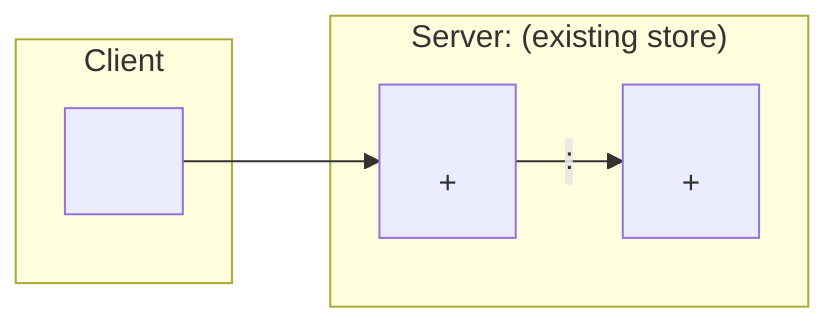
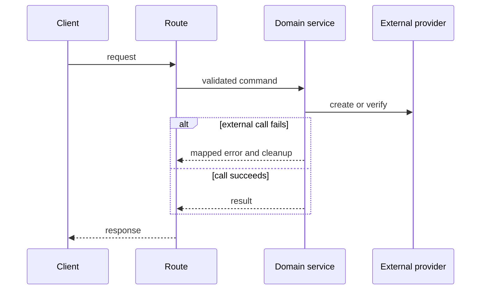
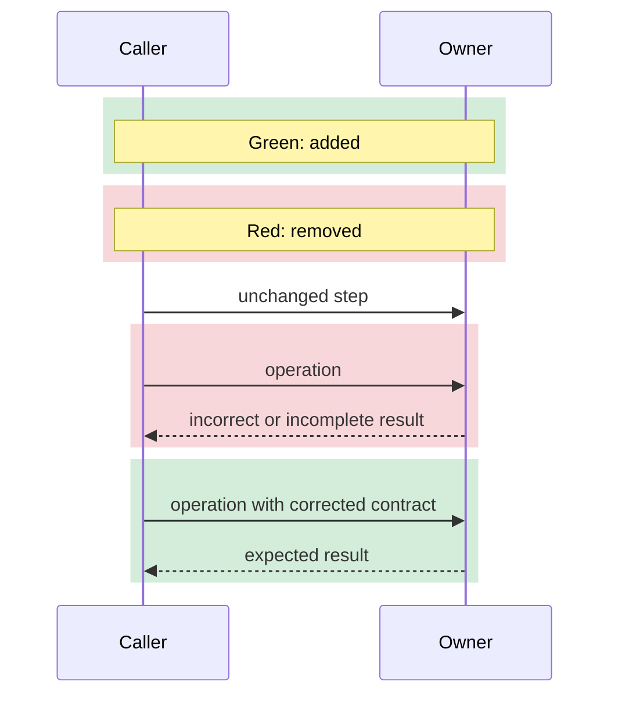
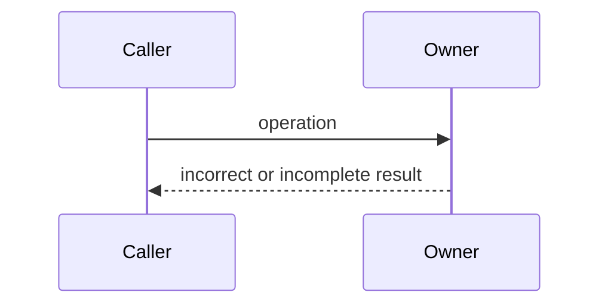
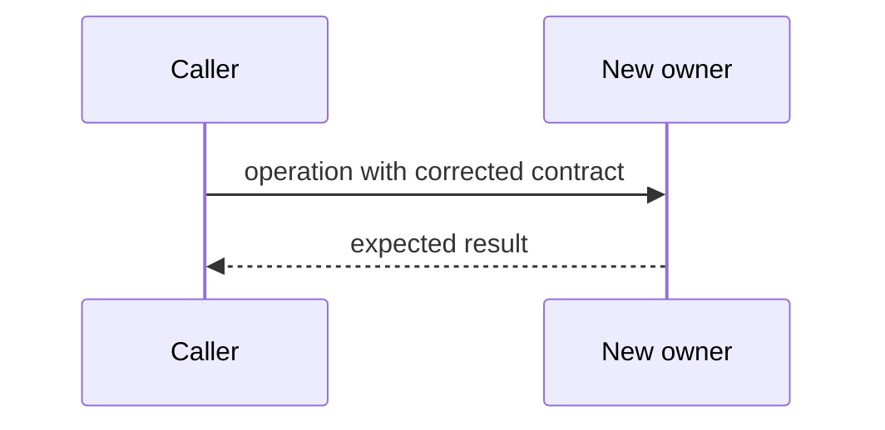
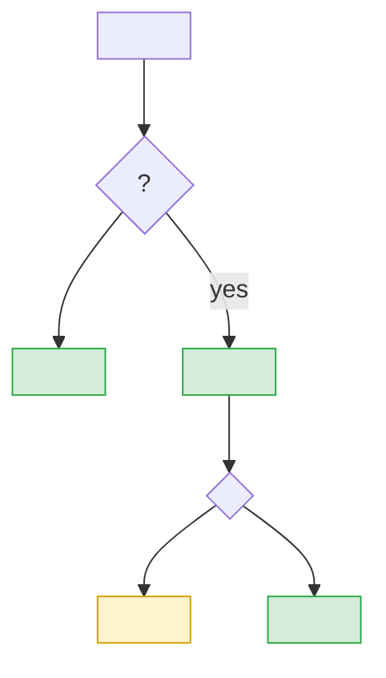

# Pull Request Body Template

Use this template as a decision guide. Keep `Summary` and `Verification`. Add other sections only when they improve the review. Do not invent content to fill a section.

The reader must see at a glance what changed and where the boundaries are. Prefer a diagram to prose and to a wide table. State each fact one time.

## Summary

Use a few lines. State the problem or capability first. Then state the result.

- What user or system behavior changed?
- Is this PR independent or stacked?

For a stacked PR, name the parent PR or branch. Separate inherited changes from this PR's own changes.

## Change map

Use this section when the diff changes several modules, responsibilities, or ownership boundaries. Do not paste the changed-file list.

Draw the modules and stores. Label each edge with the call, event, or data that moves. Mark the new parts:

When the diff changes where data or state lives, add the lifecycle. State whether each item is a new field on an existing record or a new table or collection, and whether it needs a migration:

| Data | Lives in | Deleted when |
| --- | --- | --- |
| `<data>` | `<store and record, new field or new table>` | `<event that deletes or moves it>` |

Below the diagram, name the removed responsibilities in one line.

## Architecture and behavior

The change map shows where things live. This section shows the order in which things happen. A PR that changes both needs both.

### Behavior flow

Use this diagram when the change has observable ordering, asynchronous work, events, IPC, or cleanup:

Use a state diagram instead when transitions or terminal states explain the change better. Name the correlation key and idempotency rule when they apply.

### Before and After for a fix

Use this when structure, ordering, lifecycle, or state explains the fault. Show both states in one view. Do not stack two diagrams.

When both states have the same participants, use one diagram. Put the added steps in a green block and the removed steps in a red block. Put the legend inside the diagram:

When the participants or the structure differ, put two structurally comparable diagrams side by side:

<table>
<tr><th>Before</th><th>After</th></tr>
<tr><td valign="top">

</td><td valign="top">

</td></tr>
</table>

After the diagram, describe the exact changed edge, step, owner, or transition. Do not make the reader infer the difference.

If reviewers can reasonably expect a diagram, but one does not apply, use this form:

> Not applicable: this change only updates `<documentation, constant, or local name>` and does not change runtime flow.

## Boundaries and risks

Use this section when the change has meaningful failure modes, invariants, migrations, or external effects. Include only relevant risks.

Show the boundaries as one guard flowchart. Follow the request or data along its path. Draw each guard as a decision, and each refusal, failure, or recovery as a branch. Color each node by its evidence:

Green is covered by a test, yellow is reasoned only.

Known gaps:

- `<gap, and whether it blocks merge>`

Do not put test names in the diagram. Use a table only when the boundaries do not form a path, and keep it to three rows.

Consider these risk groups when you select the guards. Do not copy the list into the PR:

- Input validation, authorization, public contracts, and defaults.
- Failure mapping, retries, duplicate events, concurrency, cancellation, ordering, and cleanup.
- Transactions, schema changes, backfills, deployment order, and rollback.
- Provider signatures, resource ownership, callback delivery, queues, and asynchronous completion.
- Identity boundaries, cross-user access, secret handling, logs, metrics, and error payloads.
- Loading, error, empty, stale, offline, navigation, and repeated-action UI states.
- Cross-window state ownership, serialization, watcher effects, and persistence ownership.

Mark missing evidence as `Not verified`. Do not convert a risk question into a claim.

## Verification

List each check and its result, one row for each. Explain a failure in the same row.

| Check | Result |
| --- | --- |
| `pnpm exec vitest run <path>` | `<result>` |
| `pnpm -F <workspace> typecheck` | `<result>` |
| `pnpm lint` | `<result>` |

Keep these evidence types separate:

- Focused tests prove the covered behavior.
- Typecheck and lint prove static checks.
- CI proves only its configured checks.
- Runtime checks prove only the inspected environment and state.
- Manual acceptance proves only the completed scenario.

List each unverified item. Do not omit it because another check passed.

## Visual changes

Use this section for user-visible UI changes. Follow the visual workflow in the main skill before you add this table.

| Before | After |
| --- | --- |
|  |  |
| `<page, component, state, viewport, theme>` | `<page, component, state, viewport, theme>` |

Use `Absent` for a new UI state. Use `Removed` for a deleted UI state.

## Rollout and follow-up

Add this optional section for migrations, feature gates, staged rollout, monitoring, known gaps, or a required follow-up PR.

Do not hide incomplete work in this section. State whether the gap blocks merge or belongs to a separate task.
